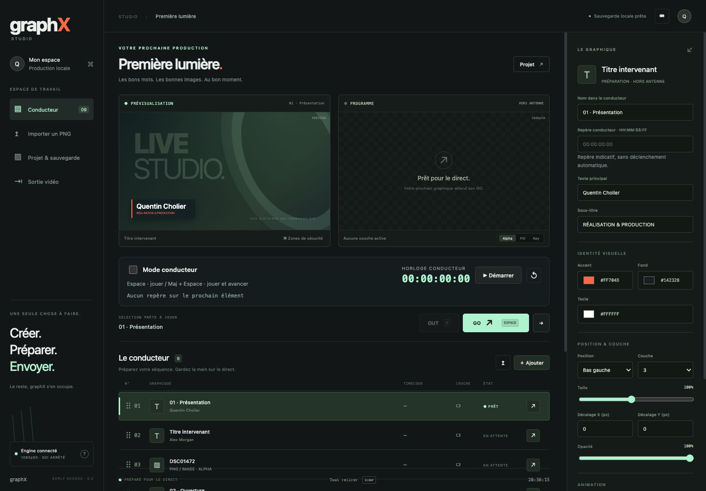

# graphX

**Un studio de titrage pour les régies vidéo.** Préparez les noms, logos et habillages dans un conducteur web, contrôlez le prochain plan en aperçu, puis envoyez les graphiques à l’antenne depuis le studio ou Companion.

[Télécharger la préversion macOS 0.4.1](https://github.com/LeQcho/graphX/releases/tag/v0.4.1) · [Essayer dans le navigateur](#essayer-dans-le-navigateur) · [Configurer la sortie Blackmagic](docs/ATEM-THUNDERBOLT.md)



## En régie

- **Préparer le conducteur** avec huit couches, des scènes multicouches, des groupes, des notes, des favoris et des imports CSV. Un export `.graphx` emporte le conducteur et ses médias.
- **Jouer les habillages** avec **GO** ou **Espace**. **O** retire l’élément sélectionné et **Échap** retire toutes les couches. Les modèles intégrés couvrent notamment les noms, logos, scores et comptes à rebours.
- **Choisir la sortie** entre une source Navigateur transparente pour OBS et le moteur natif Blackmagic Key + Fill. Le SDK Desktop Video gère les modes exposés par l’UltraStudio ou l’ATEM Mini Extreme ISO G2 en Thunderbolt.
- **Piloter depuis Companion** avec des actions, retours d’état, variables et presets. La [build d’essai Régie](docs/REGIE.md) ajoute l’import de médias pendant une prestation, trois pages de 15 touches et des commandes vidéo WebM.

## Essayer sur Mac

Télécharger l’archive de la [préversion 0.4.1](https://github.com/LeQcho/graphX/releases/tag/v0.4.1) pour **Apple Silicon**. L’application ouvre le studio dans le navigateur et garde le moteur actif dans la barre des menus. Elle est signée ad hoc à ce stade.

1. Jouer un modèle du conducteur, puis importer le [titrage PNG](examples/Titrage-transparent-1080.png) ou la [mire alpha](examples/Mire-alpha-1080.png).
2. Pour OBS, ajouter une source Navigateur transparente en suivant le [guide de premier essai](docs/PREMIER-ESSAI.md).
3. Pour Key + Fill, installer Blackmagic Desktop Video, puis choisir le périphérique, la cadence et le type d’alpha dans **Sortie vidéo**. Le [guide ATEM](docs/ATEM-THUNDERBOLT.md) détaille les sources à sélectionner côté mélangeur.

**État du projet** · Le rendu des pixels et de l’alpha a été testé. La qualification visuelle de l’incrustation dans l’ATEM et les essais de la sortie physique UltraStudio restent à réaliser. Voir le [rapport de validation](docs/VALIDATION.md).

## Essayer dans le navigateur

Avec **Node.js 22 ou ultérieur**, depuis la racine du dépôt :

```sh
npm run preview
```

Ouvrir l’adresse affichée par le serveur. L’aperçu web permet d’explorer le conducteur, les modèles et l’import. La sortie Blackmagic se teste avec l’application Mac.

## Architecture et développement

Le studio web commande un moteur Chromium hors écran. Electron gère l’application Mac et le serveur local. Un helper C++ pilote la sortie matérielle via le SDK Blackmagic. Les médias sont stockés sur le Mac hôte dans `~/Library/Application Support/graphX/`.

```sh
npm test
npm run build:engine
npm run package
```

La compilation du moteur et l’empaquetage nécessitent les outils Apple ainsi que le runtime Electron décrit dans [Architecture](docs/ARCHITECTURE.md). Consulter aussi les [avis de licences tierces](THIRD-PARTY-NOTICES.md).

<details>
<summary>Essai vidéo avec transparence</summary>

Dans la build d’essai vidéo, **Importer une vidéo** ajoute un habillage WebM au conducteur. Utilise un **WebM VP9 avec alpha**, en 1920 × 1080 maximum, jusqu’à 250 Mio et 30 minutes. La lecture est muette. Sur le PC de régie, utilise Chrome ou Edge pour l’aperçu.

La prévisualisation montre la première image. Après **GO**, le panneau sous **Programme** affiche la progression et le temps restant, avec **Pause / Reprendre**, **Repartir** et **OUT**. La vidéo se retire à la fin par défaut. L’option **Boucler jusqu’au OUT** se règle dans l’inspecteur. Un export `.graphx` inclut le fichier vidéo.

Pour convertir un master qui possède déjà un canal alpha avec FFmpeg :

```sh
ffmpeg -i habillage.mov -c:v libvpx-vp9 -pix_fmt yuva420p -crf 24 -b:v 0 -an habillage.webm
```

Vérifie la transparence en prévisualisation avant le GO. [WebM avec alpha dans Chromium](https://developer.chrome.com/blog/alpha-transparency-in-chrome-video)

</details>

## Documentation

- [Guide de premier essai](docs/PREMIER-ESSAI.md)
- [Scènes, modèles, CSV et sauvegardes](docs/LOTS-1-2.md)
- [Companion](docs/COMPANION.md) et [workflow Régie](docs/REGIE.md)
- [Sortie Thunderbolt ATEM](docs/ATEM-THUNDERBOLT.md)
